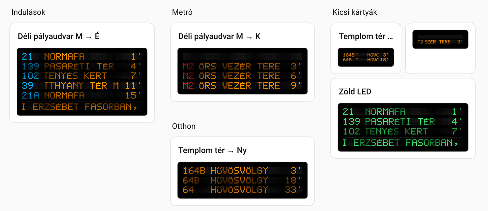
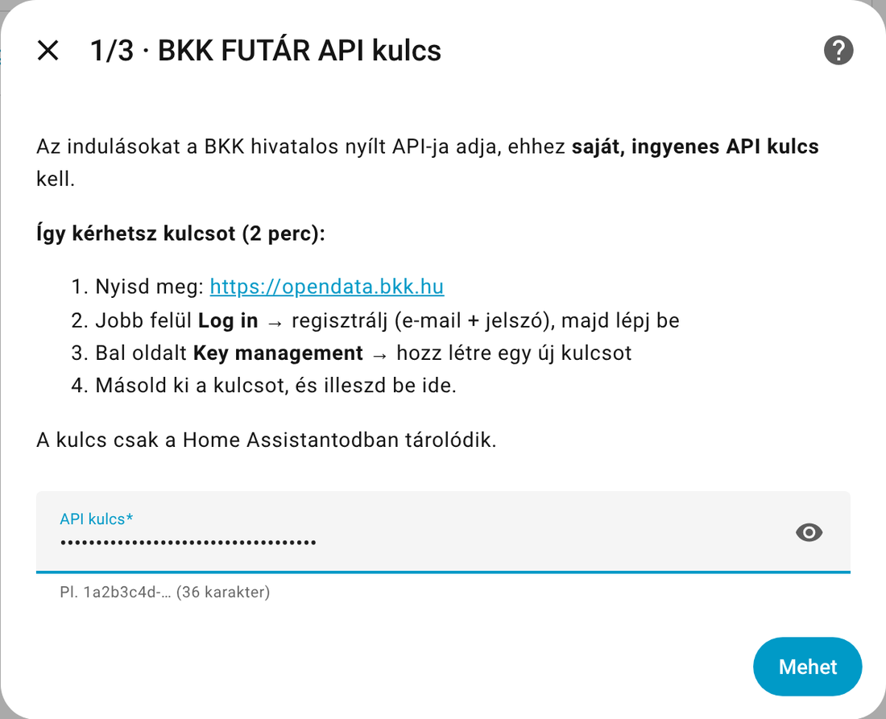
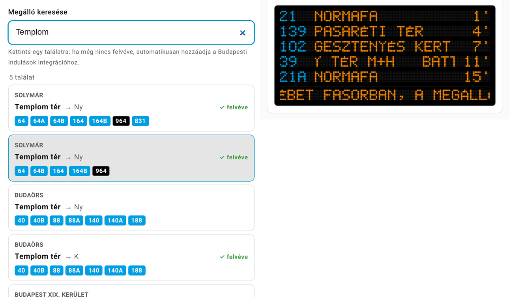
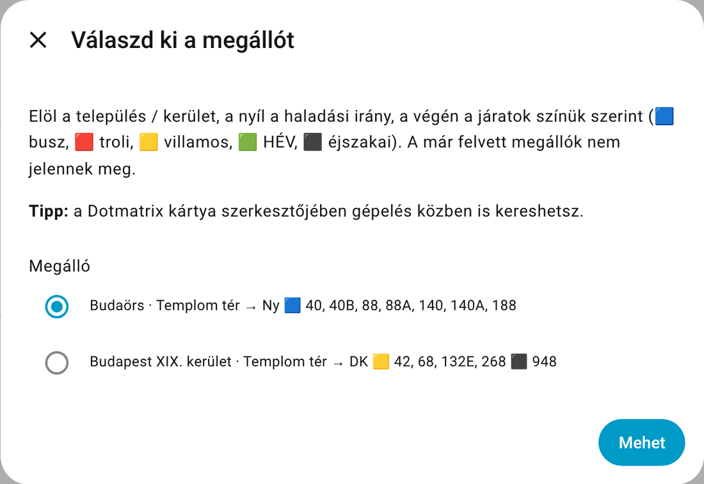
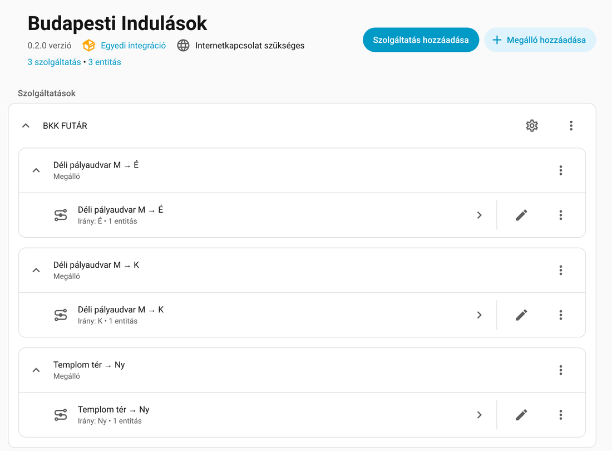

# 🚏 Budapesti Indulások – Home Assistant integráció

[](https://hacs.xyz)
[](https://github.com/szbence7/ha-budapest-departures/releases)

Bármelyik budapesti és agglomerációs megálló **valós idejű indulásai** Home Assistantban, a BKK FUTÁR hivatalos nyílt adataiból. Busz, villamos, troli, metró, HÉV és a Volánbusz agglomerációs járatai is.

A **[Dotmatrix Indulási Kijelző](https://github.com/szbence7/dot-matrix-departure-card)** kártyával olyan, mint egy igazi FUTÁR kijelző:



---

## Tartalom

1. [Mit tud?](#mit-tud)
2. [API kulcs igénylése](#1-api-kulcs-igénylése-ingyenes-2-perc)
3. [Telepítés HACS-ból](#2-telepítés-hacs-ból)
4. [Beállítás lépésről lépésre](#3-beállítás-lépésről-lépésre)
5. [Később: megálló hozzáadása, törlése, beállítások](#4-később-megálló-hozzáadása-törlése-beállítások)
6. [Mit kapsz? (szenzorok)](#5-mit-kapsz-szenzorok)
7. [Gyakori kérdések](#gyakori-kérdések)

---

## Mit tud?

- ✅ **Mindenki a saját, ingyenes API kulcsát használja** – a beállításkor kéri, és csak a te Home Assistantodban tárolódik
- ✅ **Élő megállókeresés** a kártya szerkesztőjében: gépelés közben jönnek a találatok településsel, iránnyal és színes járat-jelvényekkel
- ✅ Egyszerre **több megálló** egy beállításban, később bármikor bővíthető
- ✅ Valós idejű (előrejelzett) indulási idők, a törölt járatokat kiszűri
- ✅ Körjáratoknál (pl. 57) a fordulópont után a **valódi végállomást** mutatja
- ✅ **Forgalmi zavarok** a megállóban közlekedő járatokra
- ✅ Az indulási listát nem írja az adatbázisba, így az nem hízik tőle

---

## 1. API kulcs igénylése (ingyenes, 2 perc)

Az adatokat a BKK nyílt API-ja adja. Ehhez **mindenkinek saját kulcs kell** (ingyenes):

1. Nyisd meg: **<https://opendata.bkk.hu>**
2. Jobb felül **Log in** → ha még nincs fiókod, **regisztrálj** (e-mail + jelszó), majd lépj be
3. Bal oldali menü: **Key management** (kulcskezelés)
4. Hozz létre egy **új kulcsot** (bármilyen nevet adhatsz neki, pl. *Home Assistant*)
5. **Másold ki** a kulcsot – ezt fogod beilleszteni a beállításnál

> 💡 A kulcs kb. így néz ki: `1a2b3c4d-5e6f-7a8b-9c0d-1e2f3a4b5c6d`
>
> 🔒 Ne oszd meg senkivel, és ne tedd fel GitHubra! Ha mégis kikerült, a Key management oldalon töröld és csinálj újat.
>
> ℹ️ A portál felülete változhat; ha valami máshogy néz ki, a lényeg: belépés → kulcskezelés → új kulcs.

---

## 2. Telepítés HACS-ból

1. Home Assistant → **HACS** → jobb felső **⋮** → **Egyéni tárolók** (Custom repositories)
2. Tároló: `https://github.com/szbence7/ha-budapest-departures`, típus: **Integráció** → **Hozzáadás**
3. Keresd meg a **Budapesti Indulások**-at a HACS-ban → **Letöltés**
4. **Indítsd újra** a Home Assistantot (Beállítások → Rendszer → újraindítás)

---

## 3. Beállítás lépésről lépésre

**Beállítások → Eszközök és szolgáltatások → Integráció hozzáadása → _Budapesti Indulások_**

### 1/2 · API kulcs

A párbeszédablakban le van írva, hogyan kérhetsz kulcsot. Illeszd be, és nyomd meg a **Mehet** gombot. A rendszer azonnal ellenőrzi, hogy a kulcs működik-e.



### 2/2 · Megállók

Két lehetőséged van:

**A) A legkényelmesebb: a kártya szerkesztőjében, gépelés közben** ⭐

Válaszd a *„Később, a kártyában adom hozzá”* lehetőséget, tedd fel a **[Dotmatrix Indulási Kijelző](https://github.com/szbence7/dot-matrix-departure-card)** kártyát a dashboardra, és a szerkesztőjében kezdd el gépelni a megálló nevét. **Már gépelés közben** jönnek a találatok: elöl a **település vagy kerület**, a **haladási irány**, és a megállóban közlekedő járatok **színes jelvényekkel** (kék busz, piros troli, sárga villamos, fekete éjszakai…). Kattintasz, és a megálló azonnal felkerül.



**B) Itt, a beállításban**

Válaszd a *„Megálló keresése most”* lehetőséget, írd be a nevet, és a listából pipáld ki, ami kell (többet is lehet). A Home Assistant beállító ablakai nem tudnak gépelés közben keresni, ezért itt a találatok a név beírása után jönnek, a járatok színét pedig színes négyzetek jelzik.



Minden megálló külön **eszköz** lesz, egy-egy szenzorral.

---

## 4. Később: megálló hozzáadása, törlése, beállítások

Az integráció oldalán (**Beállítások → Eszközök és szolgáltatások → Budapesti Indulások**):



| Mit szeretnél? | Hogyan? |
|---|---|
| **Új megálló** | a kártya szerkesztőjében gépelve, vagy itt a **+ Megálló hozzáadása** gombbal |
| **Megálló törlése** | a megálló sorában **⋮ → Törlés** |
| **Frissítési idő, időablak** | a **fogaskerék** ikon a *BKK FUTÁR* sorban |
| **API kulcs cseréje** | *BKK FUTÁR* sor **⋮ → Újrakonfigurálás** |

**Beállítások (fogaskerék):**

| Beállítás | Alapérték | Mire jó? |
|---|---|---|
| Frissítési idő | 30 mp | Ilyen gyakran kérdezi le a BKK-t (15–300 mp). Kíméld az ingyenes API-t. |
| Időablak | 60 perc | Ennyi percre előre nézi az indulásokat |
| Tárolt indulások száma | 10 | Ennyi indulás kerül a szenzor attribútumába (a kártya ebből dolgozik) |

---

## 5. Mit kapsz? (szenzorok)

Megállónként egy szenzor, pl. `sensor.templom_ter_ny_kovetkezo_indulas`

- **Állapot:** hány perc múlva indul a következő járat
- **Attribútumok:** a teljes indulási lista

```yaml
stop_id: BKK_F04706
stop_name: Templom tér
direction: Ny
alert: "57: Terelés ..."
departures:
  - route: 164B            # járatszám
    headsign: Hűvösvölgy   # végállomás
    minutes: 12            # hány perc múlva
    departure: 1793605472  # indulás (unix idő)
    realtime: true         # valós idejű adat (true) vagy menetrend szerinti (false)
    color: "#009EE3"       # a járat hivatalos színe
    vehicle_type: BUS
    night: false           # éjszakai járat
```

**Automatizálás ötlet:** értesítés, ha 5 percen belül indul a buszod:

```yaml
trigger:
  - platform: numeric_state
    entity_id: sensor.templom_ter_ny_kovetkezo_indulas
    below: 6
action:
  - action: notify.mobile_app_telefonom
    data:
      message: >
        {{ state_attr('sensor.templom_ter_ny_kovetkezo_indulas', 'departures')[0].route }}
        {{ states('sensor.templom_ter_ny_kovetkezo_indulas') }} perc múlva indul!
```

---

## Gyakori kérdések

**„Érvénytelen API kulcs” hibát kapok.**
Ellenőrizd, hogy a teljes kulcsot másoltad-e ki (szóköz nélkül). Ha a kulcsot törölted a portálon, a Home Assistant magától kér újat.

**Nem találom a megállómat.**
Próbáld rövidebben vagy ékezettel (pl. *Széll Kálmán* helyett *Széll*). A metró- és HÉV-megállók neve sokszor „M” vagy „H” végű (pl. *Déli pályaudvar M*).

**Melyik irányt válasszam?**
Nézd a járatlistát: a megálló melyik oldalán áll az a busz, amire felszállsz. Ha bizonytalan vagy, vedd fel mindkét irányt.

**Mennyire terheli a BKK-t?**
Megállónként 30 másodpercenként egy lekérés (állítható). A körjáratok végállomását egyszer kérdezi le, utána megjegyzi.

**Frissítettem 0.1-ről, megmaradnak a megállóim?**
Igen, a régi beállítást automatikusan átalakítja az új formára.

---

## Fontos

Nem hivatalos projekt, a BKK Zrt.-hez nincs köze. Adatok: BKK FUTÁR nyílt adatok (opendata.bkk.hu). A települések nevét az irányítószámból a Magyar Posta és a KSH nyilvános adatai alapján adjuk meg ([ferenci-tamas/IrszHnk](https://github.com/ferenci-tamas/IrszHnk) összerendelés).

## Támogatás

Ha megspórol pár percet a megállóban, meghívhatsz egy kávéra. Köszönöm! ☕

[](https://www.buymeacoffee.com/benceix)
